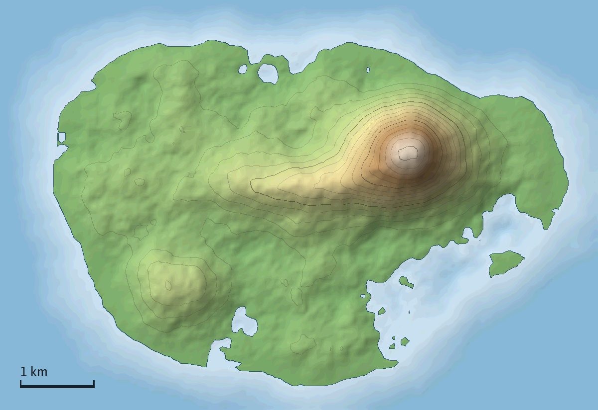
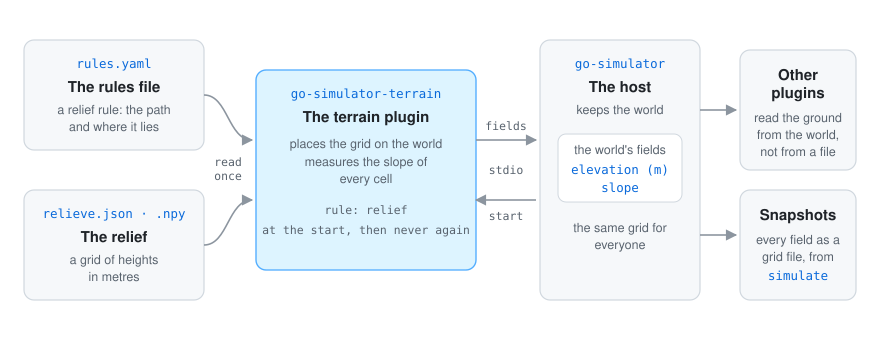

<div align="center">


# Go terrain simulator

**The ground of a simulation, as a plugin for [go-simulator](https://github.com/akrck02/go-simulator).**
It reads a relief once and puts it in the world as two fields, `elevation` (metres) and `slope`,
so every other plugin reads the same ground from the world instead of loading its own file.
Its `erosion` rule lets that ground change: the land rises, rivers cut valleys and hillslopes
round off, and the rivers it finds go into the world too.

[](go.mod)


</div>

## 🤖 AI disclosure

I write most of my code by hand, so I want to be clear about this project: **it was written by an
AI assistant (Claude, by Anthropic) under my direction.** I decided what to build and how it should
behave; the code, the tests and the documentation were written by the AI. Every commit made this
way carries a `Co-Authored-By: Claude` line (all of them).

**Status: pending thorough review.** The code compiles and its tests pass, but I have not yet
reviewed it line by line. Treat it as a working draft, not as code I vouch for.

---

<p align="center">
<picture>
  <source media="(prefers-color-scheme: dark)" srcset="docs/images/hero-dark.png">
  
</picture>
</p>

<p align="center"><sub>A made-up island's <code>elevation</code>, exactly as the plugin published it to the world in a real run, shaded and with a contour every 50 m.</sub></p>

## ✨ What it looks like

<p align="center">
<picture>
  <source media="(prefers-color-scheme: dark)" srcset="docs/images/fields-dark.png">
  
</picture>
</p>

<table>
<tr>
<th width="33%"><code>elevation</code></th>
<th width="33%"><code>slope</code></th>
<th width="33%">Two formats, one ground</th>
</tr>
<tr>
<td>The relief's heights in metres, untouched, one value at the centre of every cell.</td>
<td>How steep every cell is, rise over run: 1 is a 45° flank. Flats are pale, the peak's sides dark.</td>
<td>The same island read as a <code>relieve.json</code> or as a NumPy <code>.npy</code> gives byte-identical fields.</td>
</tr>
</table>

<p align="center">
  
</p>

## 🚀 Quick start

Clone [go-simulator](https://github.com/akrck02/go-simulator), go-scene-builder and go-renderer
next to this repository, then put the plugin first in a rules file:

```yaml
plugins:
  - {name: terrain, command: [go, run, .], directory: ../go-simulator-terrain}
stages:
  - name: ground
    clock: {from: 0, to: 1, step: 1}
    rules:
      - {rule: relief, with: {path: relieve.json, origin: [6, 4.5]}}
```

and run it from go-simulator:

```bash
cd ../go-simulator
go run ./cmd/simulate -rules ../go-simulator-terrain/examples/ground.yaml -output results/
```

With a relief next to the example, `results/` gets `ground 1 elevation.json` and
`ground 1 slope.json`, each with its `.f32` of values.
[More on getting started →](docs/3-getting-started.md)

## 🔍 How it works

<p align="center">
  
</p>

go-simulator starts the plugin and tells its `relief` rule to start. The rule reads the file, lays
the grid on the world, measures the slope of every cell and sets both fields. On its own the ground does not
change with time, so every later step answers with nothing; with the `erosion` rule after it, the
ground evolves every step and is published again with its drainage and rivers.
[More on how it works →](docs/6-how-it-works.md)

## 📚 Documentation

| | |
|---|---|
| [The terrain quest](docs/2-the-quest.md) | Shape an island with water and time in 5 levels. |
| [Getting started](docs/3-getting-started.md) | The folders it needs, the example, your own relief, the output files and the tests. |
| [Reliefs and fields](docs/4-reliefs-and-fields.md) | What it publishes, how the slope is measured, the two relief formats and how they lie on the world. |
| [Erosion and rivers](docs/5-erosion-and-rivers.md) | How the `erosion` rule lets the ground change: uplift, valleys, hillslopes, the rivers it publishes and what a year means. |
| [How it works](docs/6-how-it-works.md) | How the plugin fits go-simulator, what happens at every step, and how the pictures were made. |
| [Rules reference](docs/7-rules-reference.md) | The `relief` and `erosion` rules and their parameters, generated from the plugin's own description. |
