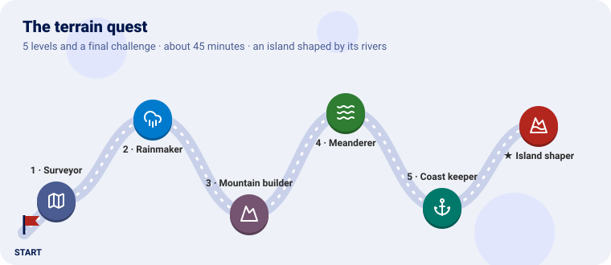
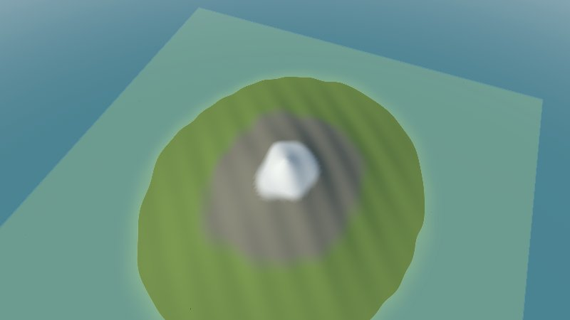
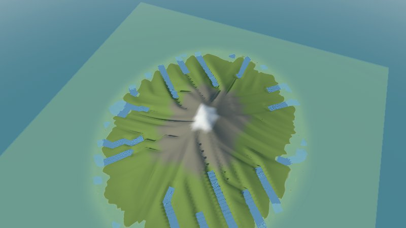
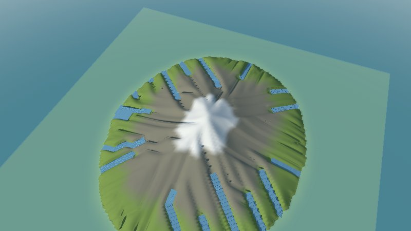
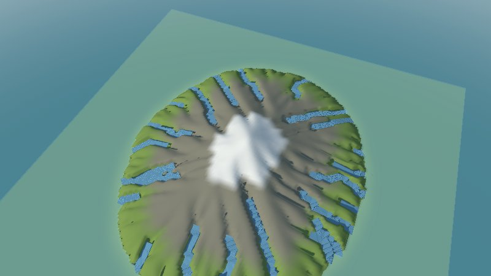
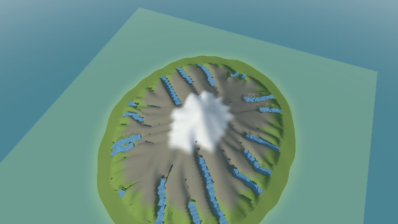
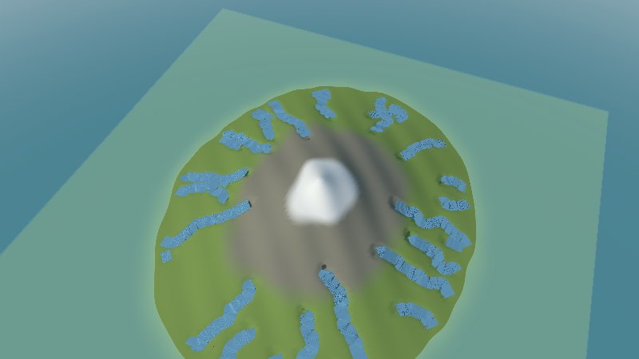
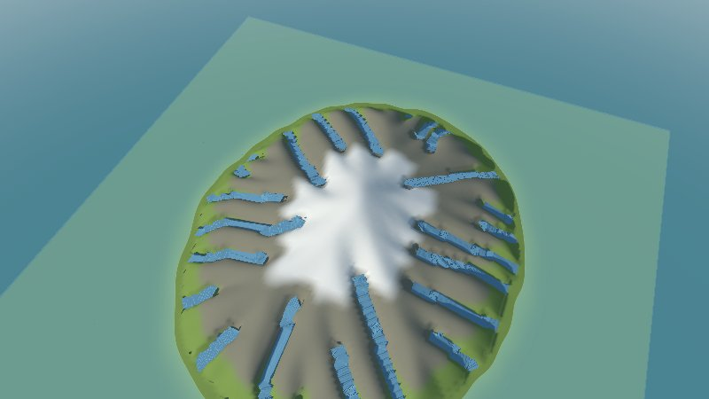
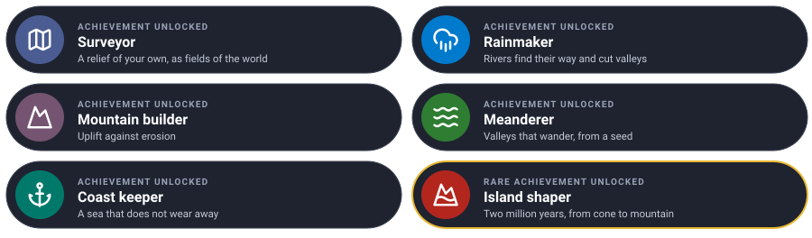

# The terrain quest

Shape an island with water and time, one level at a time. Each level teaches one piece of the
terrain plugin and ends with a new island to look at in 3D.



We start from a smooth **volcano** of your own, 800 metres high, and let **rivers** find their way
down it, **uplift** push it up, **valleys** wander, and the **sea** hold its coast, until two
million years have made a mountain island.

---

Every level has the same shape: **the idea** (explained with something from everyday life), **the
rules**, a **checkpoint** to know it works, and an optional **bonus**.

---

## Before you start

You need Go 1.25 and GEOS (`sudo apt install libgeos-dev`, `brew install geos`), for looking at the
results with Go Scene Builder. Clone the projects side by side, and make a folder for the quest:

```sh
git clone https://github.com/akrck02/go-renderer
git clone https://github.com/akrck02/go-scene-builder
git clone https://github.com/akrck02/go-simulator
git clone https://github.com/akrck02/go-simulator-terrain
mkdir island && cd island
go mod init example.com/island
```

### Looking at a result

The plugin publishes **fields**: a grid of numbers over the world, such as the height of every
cell. A run without a window writes each field in Go Scene Builder's relief format, so the builder
can turn it into a 3D scene for Go Renderer's viewer. Three files do it, made once:

`view.yaml`, how the island looks (green low down, rock higher, snow at the top, a sea at 0 m, the
rivers as water):

```yaml
units: m
chunk: 2
environment: {sun: [220, 35], water_level: 0}
terrain: {color: "#7f9a4e", bands: [{above: 250, color: "#8a8674", blend: 80}, {above: 600, color: "#e9e7e1", blend: 60}]}
rules:
  - when: {kind: river}
    shape: {role: water, width: "width * 1000"}
```

`look/main.go`, which tells the builder how a snapshot's map is written (kilometres, with z growing
to the south):

```go
// Command look turns a snapshot's entities into a map go-scene-builder reads: the snapshot writes
// [x, z] in kilometres, with z to the south, and the builder needs to be told so.
//
//	go run ./look "results/island 100.geojson" map.geojson
package main

import (
	"encoding/json"
	"log"
	"os"
)

func main() {
	content, err := os.ReadFile(os.Args[1])
	if err != nil {
		log.Fatal(err)
	}
	var collection map[string]any
	if err := json.Unmarshal(content, &collection); err != nil {
		log.Fatal(err)
	}
	properties, _ := collection["properties"].(map[string]any)
	if properties == nil {
		properties = map[string]any{}
	}
	properties["units"], properties["axes"] = "km", "east-south"
	collection["properties"] = properties
	out, _ := json.Marshal(collection)
	if err := os.WriteFile(os.Args[2], out, 0o644); err != nil {
		log.Fatal(err)
	}
}
```

And the three commands, after every run (here for the snapshot at time 100 of the stage `island`):

```sh
go run ./look "results/island 100.geojson" map.geojson
go run ../go-scene-builder/cmd/build-scene -map map.geojson -relief "results/island 100 elevation.json" -style view.yaml -out island.glb
go run ../go-renderer/cmd/visor island.glb
```

The pictures were taken with `-zoom 0.75` in the viewer.

---

## Level 1 · The Surveyor

| Mission | Pieces | Time |
|---|---|---|
| A volcano of your own, in the world | the relief format, the `relief` rule, fields, snapshots | 10 min |

#### The idea

A **relief** is a **chessboard of heights**: every square says how high the ground is. It lives
in two files, a small label (`relieve.json`: how many squares, how big, where) and the heights
themselves (`relieve.f32`: one number per square, row by row from the north).

The `relief` rule reads it and puts it in the world as two **fields**: `elevation` (metres) and
`slope` (how steep, rise over run). Other plugins read those fields; the terrain plugin's other
rule will change them.

#### Build it

`island/main.go` writes the volcano, 8 × 8 km in cells of 50 m:

```go
// Command island writes a made-up island: relieve.json, the grid's size and place in kilometres,
// and relieve.f32, a height in metres for every cell, row by row from the north.
package main

import (
	"encoding/binary"
	"encoding/json"
	"log"
	"math"
	"os"
)

func main() {
	const (
		columns, rows = 160, 160 // cells
		cell          = 0.05     // kilometres a side: 50 m
		west, north   = -4.0, 4.0
	)
	heights := make([]float32, 0, columns*rows)
	for row := range rows {
		for column := range columns {
			east := west + (float64(column)+0.5)*cell
			northing := north - (float64(row)+0.5)*cell
			heights = append(heights, float32(height(east, northing)))
		}
	}
	header, _ := json.Marshal(map[string]any{"columns": columns, "rows": rows, "cell": cell, "west": west, "north": north, "units": "km"})
	if err := os.WriteFile("relieve.json", header, 0o644); err != nil {
		log.Fatal(err)
	}
	file, err := os.Create("relieve.f32")
	if err != nil {
		log.Fatal(err)
	}
	defer file.Close()
	if err := binary.Write(file, binary.LittleEndian, heights); err != nil {
		log.Fatal(err)
	}
}

// height is a volcano-shaped island 800 m high, a little lopsided, under the sea at its edges.
func height(east, north float64) float64 {
	distance := math.Hypot(east*1.2, north) // wider east to west
	shoulder := math.Max(0, 1-distance/3.2)
	// ridges and hollows of a few sizes, so the rivers have somewhere to start
	bumps := 60*math.Sin(east*2.3+1)*math.Cos(north*1.7) + 30*math.Sin(east*5.1)*math.Sin(north*4.3+2) + 15*math.Cos(east*9.7+north*8.9)
	return 820*math.Pow(shoulder, 1.6) + bumps*shoulder - 30
}
```

```sh
go run ./island
```

`rules.yaml`, one stage of one step that snapshots the world at its end:

```yaml
plugins:
  - name: terrain
    command: [go, run, .]
    directory: ../go-simulator-terrain

stages:
  - name: ground
    clock: {from: 0, to: 1, step: 1}
    snapshots: [1]
    rules:
      - rule: relief
        with: {path: relieve.json, origin: [0, 0]}
```

```sh
go run ../go-simulator/cmd/simulate -rules rules.yaml -output results/
```

#### Checkpoint

`results/` holds `ground 1 elevation.json` and `.f32`, `ground 1 slope.json` and `.f32`. Look at
the elevation (the snapshot is `ground 1`): a smooth cone in the sea, green at the shore, rock on
its shoulders, snow on top.



#### Bonus (optional): two peaks

<details>
<summary>🔓 Show the solution</summary>

Add a second cone to `height`: `+ 500*math.Pow(math.Max(0, 1-math.Hypot(east-2, north+1.5)/1.5), 1.6)`.

</details>


Learn more: [Reliefs and fields](4-reliefs-and-fields.md#formats) · [Rules](7-rules-reference.md#relief)

---

## Level 2 · The Rainmaker

| Mission | Pieces | Time |
|---|---|---|
| Rivers that find their way down and cut valleys | the `erosion` rule, years per step, drainage | 8 min |

#### The idea

Pour a **glass of water** on a sandcastle: it runs down the steepest way, gathers in gullies, and
the more water a gully carries, the faster it digs. That is the **stream power law**: erosion grows
with the area a river drains and the slope it runs down. Over thousands of years, gullies become
valleys.

Each step of the clock stands for as many years as `years_per_unit` says: 100 steps of 10,000
years are a million.

#### Build it

A stage of 100 steps, with the relief first and erosion after it:

```yaml
plugins:
  - name: terrain
    command: [go, run, .]
    directory: ../go-simulator-terrain

stages:
  - name: island
    clock: {unit: year, from: 0, to: 100, step: 1}
    snapshots: [0, 100]
    snapshot_fields: [elevation, drainage_area]
    rules:
      - rule: relief
        with: {path: relieve.json, origin: [0, 0]}
      - rule: erosion
        with: {years_per_unit: 10000, erodibility: 0.000002, river_area: 0.3}
```

`river_area` says from how many km² drained a stream counts as a river: those become entities of
kind `river`, which `look` puts on the map.

#### Checkpoint

The run takes a second or two. At 100, the volcano is lower and scored by gullies, with rivers down
to the sea.



#### Bonus (optional): softer rock

<details>
<summary>🔓 Show the solution</summary>

`erodibility: 0.00001`: rock five times as soft wears five times as fast.

</details>


Learn more: [How it works](6-how-it-works.md) · [Erosion](5-erosion-and-rivers.md)

---

## Level 3 · The Mountain builder

| Mission | Pieces | Time |
|---|---|---|
| Uplift that pushes the island up as the rivers wear it down | `uplift` | 5 min |

#### The idea

An **escalator going up** while you walk down: if you walk as fast as it climbs, you stay where you
are. Mountains are like that: the earth pushes them up, rivers wear them down, and they settle
where the two balance.

#### Build it

The erosion rule's parameters only:

```yaml
        with: {years_per_unit: 10000, uplift: 0.0002, erodibility: 0.000002, river_area: 0.3}
```

0.0002 m a year is 2 metres every 10,000 years.

#### Checkpoint

The island grows **taller**, the snow reaches lower, and the valleys run straight from the top, like
the spokes of a wheel: water always takes the steepest of the eight neighbours of a cell, so it
follows the grid.



#### Bonus (optional): find the balance

<details>
<summary>🔓 Show the solution</summary>

Run 300 steps instead of 100 and snapshot at 100, 200 and 300: the peak stops rising once erosion
takes away what uplift brings.

</details>


---

## Level 4 · The Meanderer

| Mission | Pieces | Time |
|---|---|---|
| Valleys that wander, the same every run | `random_receivers`, `seed` | 5 min |

#### The idea

Real water does not always take the single steepest way: a **pinball** bounces down a slope, more
often down the steeper side, never quite the same line. With `random_receivers`, water picks a
lower neighbour **by chance, weighted by its slope**. The `seed` makes the chance repeatable: the
same seed, the same valleys.

#### Build it

```yaml
        with: {years_per_unit: 10000, uplift: 0.0002, erodibility: 0.000002, river_area: 0.3, random_receivers: true, seed: 7}
```

#### Checkpoint

The spokes are gone: valleys bend and join as on a real mountain. Run it twice: the two islands are
identical. Change the seed: other valleys.



#### Bonus (optional): rounder hills

<details>
<summary>🔓 Show the solution</summary>

`diffusivity: 0.02`: hillslopes creep downhill and round off, as soil does over centuries; the
ridges between valleys soften.

</details>


---

## Level 5 · The Coast keeper

| Mission | Pieces | Time |
|---|---|---|
| A sea level the rivers stop at | `sea_level` | 4 min |

#### The idea

A river stops cutting where it meets the sea: the sea is its **floor**. Ground under `sea_level` is
sea, and does not change, so the coast holds while the land above it is carved.

#### Build it

```yaml
        with: {years_per_unit: 10000, uplift: 0.0002, erodibility: 0.000002, river_area: 0.3, random_receivers: true, seed: 7, sea_level: 60}
```

#### Checkpoint

Below 60 m, a ring of the old smooth slope stays as it was, a green shore round the island; above
it, the valleys reach down to it.




Learn more: [Rules: erosion](7-rules-reference.md#erosion)

---

## Final challenge · Island shaper

Run **two million years** on the volcano, with uplift, wandering valleys, rounder hills and a sea
at 20 m, and snapshot the start, the middle and the end. Then look at the start and the end side by
side.

> **Hint:** 200 steps of 10,000 years; three snapshots; all the parameters of levels 2 to 5, a lower
> `river_area` for more rivers.

Try it on your own first, then compare with the solution.





<details>
<summary>🔓 Show the solution</summary>

<pre><code>    clock: {unit: year, from: 0, to: 200, step: 1}
    snapshots: [0, 100, 200]
    snapshot_fields: [elevation, drainage_area]
    rules:
      - rule: relief
        with: {path: relieve.json, origin: [0, 0]}
      - rule: erosion
        with: {years_per_unit: 10000, uplift: 0.0002, erodibility: 0.000002, diffusivity: 0.01, river_area: 0.2, random_receivers: true, seed: 7, sea_level: 20}</code></pre>

Then `look`, `build-scene` and the viewer on `island 0` and `island 200`.

</details>


---

## Well done



You made a relief, put it in a world, and wore it into a mountain with the same laws real
geomorphologists use.

### Ideas to keep going

| Idea | Difficulty | Hint |
|---|---|---|
| Wider rivers | ⭐ | `river_width: [6, 0.5]` |
| The made-up island that comes with the plugin | ⭐ | `examples/eroding-island.yaml`, a `.npy` relief |
| Give it a climate | ⭐⭐ | [The climate plugin](https://github.com/akrck02/go-simulator-climate) reads `elevation` from the world: put its rule after these |
| Forests on it | ⭐⭐⭐ | [The flora plugin](https://github.com/akrck02/go-simulator-flora), after the climate |

## Troubleshooting

| You see | Why, and what to do |
|---|---|
| `relief: unknown units` | `units` in `relieve.json` must be `km` or `m` |
| The island is mirrored north to south, the rivers off the valleys | The map was not run through `look`: the snapshot writes z to the south |
| No rivers at all | `river_area` is larger than any river's drainage: lower it, or run longer |
| The island sinks into the sea | Erosion with no uplift only lowers it: add `uplift`, or fewer steps |
| `pkg-config: geos not found` | GEOS is needed by Go Scene Builder, to look at the result |

---

[← All the documentation](1-overview.md)
