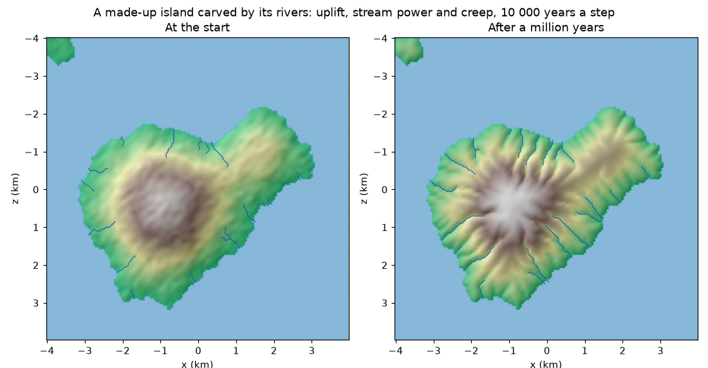

# Erosion and rivers

A relief read from a file stays as it is. The `erosion` rule lets it change: the land rises, the
rivers cut their valleys deeper and the hillslopes round off, step after step, and the rivers come
out of where the water gathers. The other plugins read the changed ground, its drainage and its
rivers from the world.



*The example island (`examples/eroding-island.yaml`): each step stands for 10 000 years. The valleys
deepen and branch, and the rivers grow longer as more ground drains into them.*

Put it after the `relief` rule: it starts from the `elevation` the world already has.

```yaml
- rule: relief
  with: {path: island.npy, minimum_x: -4, minimum_z: -4, cell_size: 0.05}
- rule: erosion
  with: {years_per_unit: 10000, uplift: 0.0002, erodibility: 0.000002, random_receivers: true}
```

## The model

The rule is a landscape evolution model of the usual kind (Tucker and Hancock 2010). Every cell of
the ground follows

    dz/dt = U − K·A^m·S + κ·∇²z

- **U, uplift** (`uplift`, metres a year): the land rises, all of it at the same pace.
- **K·A^m·S, the stream power law** (Howard 1994; Whipple and Tucker 1999): water cuts into the
  ground faster where more of it runs (A, the area that drains through the cell, stands for the
  discharge) and where it runs steeper (S, the slope towards the cell it goes to). K
  (`erodibility`) says how easily the rock gives way and m (`area_exponent`) how much the amount
  of water counts; the slope's exponent is 1.
- **κ·∇²z, soil creep** (`diffusivity`, m² a year): hillslopes round off, because soil slowly moves
  from the convex tops to the concave feet (Fernandes and Dietrich 1997; Roering et al. 1999).

The sea (ground at or below `sea_level`) and the cells on the edge of the grid are the **base
level**: they do not change, and every drop of water ends in one of them. A relief cut out of a
larger map lets its rivers leave through the edges.

### How it is solved

Every piece of time:

1. **Drainage.** The hollows are filled for the water (priority flood, Barnes et al. 2014), so water
   from every cell reaches the base level, and each cell gives its water to its steepest lower
   neighbour of eight. The area drained adds up from the highest cells down.
2. **Uplift**, on everything but the base level.
3. **Valleys.** The stream power law is solved implicitly, from the lowest cells up (Braun and
   Willett 2013): it is stable for any length of time and a cell never ends lower than the cell
   its water goes to. A cell lower than that one lies in a hollow and is left alone, so the
   hollows of the relief stay where they are.
4. **Creep**, with the four neighbours of each cell. Creep is only stable for short pieces of time
   (κ·Δt/Δx² ≤ 0.2), so a long step is cut into as many pieces as it needs.

The heights are kept in float64 between steps: a change of a fraction of a millimetre a year would
be lost if it were rounded to the float32 of the fields every year.

**Drawn receivers.** Always sending the water to the steepest of eight neighbours cuts straight
valleys lined up with the grid, which a shaded relief shows as stripes. With `random_receivers`,
each cell sends its water to one of its lower neighbours drawn with a chance that grows with the
square of its slope, so the valleys wander like real ones. The draws come from `seed`: the same
seed, the same valleys.

## What a year means

The numbers of the model are in metres and years, and `years_per_unit` says how many years of
erosion each unit of the stage's clock stands for. With the default of 1, a year of the clock is a
year of erosion, and the ground hardly moves: rivers lower their beds by tenths of a millimetre a
year, so a town that grows for a century sees its ground change by centimetres at the most. To see
valleys form, make every step stand for thousands of years (`years_per_unit: 10000`), in a stage of
its own before the stages that use the ground.

## What it publishes

At the start and then every `publish_every` steps:

| What | Kind | Unit |
|---|---|---|
| `elevation`, `slope` | fields | metres; rise over run |
| `drainage_area` | field | km² of ground that drains through each cell (0 on the base level) |
| rivers | entities of kind `river`: a line with a width | world units; properties `width` (world units) and `drainage_area` (km² where the river ends) |

A river starts where the drained area reaches `river_area` (channel heads drain from hundredths of
a km² to about one; Montgomery and Dietrich 1988) and runs down to the sea, the edge or a bigger
river. The rivers that drain most are traced first, so a main river keeps its whole length and its
tributaries end where they meet it. Its width grows with the area it drains, as hydraulic geometry
finds for the discharge (Leopold and Maddock 1953): `width = river_width[0] · area^river_width[1]`,
3 m · area(km²)^0.5 by default. The line goes through the cell centres, with its corners rounded
(Chaikin 1974). Each river is named after the cell where it starts, so a river that only changes
a little is modified, not replaced.

## Numbers

The defaults are middle values from the literature; set them for your own place.

| Parameter | Default | Range in the literature |
|---|---|---|
| `erodibility` | 1e-5 a year⁻¹ (m = 0.5) | about 1e-7 to 1e-4, from hard to soft rock (Stock and Montgomery 1999; Harel et al. 2016) |
| `area_exponent` | 0.5 | concavity m/n of 0.3 to 0.7, 0.5 most often (Whipple and Tucker 1999) |
| `diffusivity` | 0.005 m² a year | 0.001 to 0.01 m² a year on soil-mantled hillslopes (Fernandes and Dietrich 1997; Roering et al. 1999) |
| `uplift` | 0 | tenths of a millimetre to a few millimetres a year in active mountains |
| `river_area` | 1 km² | channel heads drain from hundredths of a km² to about one (Montgomery and Dietrich 1988) |
| `river_width` | [3, 0.5] | the exponent 0.5 is hydraulic geometry's (Leopold and Maddock 1953); the coefficient is a round value |

## References

- Barnes, R., Lehman, C. and Mulla, D. (2014). Priority-flood: an optimal depression-filling and
  watershed-labeling algorithm for digital elevation models. *Computers & Geosciences* 62.
- Braun, J. and Willett, S. D. (2013). A very efficient O(n), implicit and parallel method to solve
  the stream power equation governing fluvial incision and landscape evolution. *Geomorphology* 180–181.
- Chaikin, G. M. (1974). An algorithm for high-speed curve generation. *Computer Graphics and Image
  Processing* 3.
- Fernandes, N. F. and Dietrich, W. E. (1997). Hillslope evolution by diffusive processes: the
  timescale for equilibrium adjustments. *Water Resources Research* 33.
- Harel, M.-A., Mudd, S. M. and Attal, M. (2016). Global analysis of the stream power law
  parameters based on worldwide ¹⁰Be denudation rates. *Geomorphology* 268.
- Howard, A. D. (1994). A detachment-limited model of drainage basin evolution. *Water Resources
  Research* 30.
- Leopold, L. B. and Maddock, T. (1953). The hydraulic geometry of stream channels and some
  physiographic implications. USGS Professional Paper 252.
- Montgomery, D. R. and Dietrich, W. E. (1988). Where do channels begin? *Nature* 336.
- Roering, J. J., Kirchner, J. W. and Dietrich, W. E. (1999). Evidence for nonlinear, diffusive
  sediment transport on hillslopes and implications for landscape morphology. *Water Resources
  Research* 35.
- Stock, J. D. and Montgomery, D. R. (1999). Geologic constraints on bedrock river incision using
  the stream power law. *Journal of Geophysical Research* 104.
- Tucker, G. E. and Hancock, G. R. (2010). Modelling landscape evolution. *Earth Surface Processes
  and Landforms* 35.
- Whipple, K. X. and Tucker, G. E. (1999). Dynamics of the stream-power river incision model.
  *Journal of Geophysical Research* 104.
