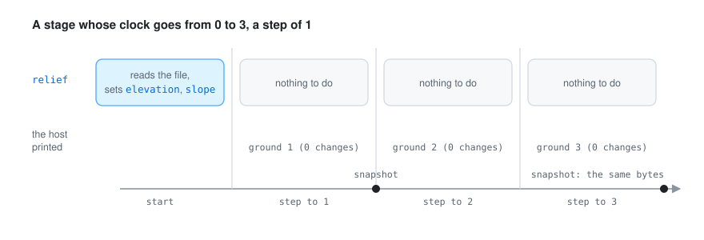

# 🔍 How it works

## How the plugin fits go-simulator

  

go-simulator is the host. It keeps the world and moves the clock. The terrain plugin is a separate
program the host starts; they talk over standard input and output (go-simulator's
[protocol](https://github.com/akrck02/go-simulator/blob/main/docs/protocol.md)).

- At the start the plugin **describes** itself: one rule, `relief`, its parameters, that it reads
  nothing from other plugins and that it writes `elevation` and `slope`. That description is also
  where the [rules reference](rules.md) comes from.
- When the stage starts, the rule reads the relief, lays it on the world (see
  [formats](model.md#formats)), measures the slope of every cell (see
  [how the slope is measured](model.md#how-the-slope-is-measured)) and sets both fields.
- Other plugins read the ground from the world, as the fields `elevation` and `slope`, instead of
  loading the file themselves. Put the terrain plugin first: plugins start in order, so the ones
  after it find the ground already there.

A plugin never touches the renderer: it reads its copy of the world and answers with changes
(go-simulator's [writing plugins](https://github.com/akrck02/go-simulator/blob/main/docs/writing-plugins.md)).
Fields are in physical units and shapes in world units, as go-simulator's
[vocabulary](https://github.com/akrck02/go-simulator/blob/main/docs/vocabulary.md) lists.

## What happens at every step

  

On its own the ground does not change with time. The `relief` rule publishes it once, when the
stage starts, so every plugin has it before its first step; if a host did not call the start, the
first step publishes it instead. Every later step answers with nothing. The
[`erosion` rule](erosion.md), put after it, is the one that changes the ground over the steps.

The picture is a real run: a stage from 0 to 3 with the island of the other pages, where
`simulate` printed `0 changes` for every step and the snapshots taken after steps 1 and 3 hold
byte-identical fields.

## How the pictures were made

The pictures of the island (the map at the top of the README, the two fields, and the profile along
A–B) were drawn from the plugin's own answers. A small throwaway program, kept outside the
repository, wrote a made-up island as a `relieve.json` and `relieve.f32`, 160 × 110 cells of 50 m,
from a few smooth hills and some noise, and the same heights as a `.npy`. go-simulator's `simulate`
ran the real plugin on both, and a second throwaway program drew the snapshot files it wrote:
the elevation shaded and coloured by height with a line every 50 m, the slope on its own scale, and
one row of both as a profile.

The maps are PNG pairs, one for light and one for dark mode; the profile is an SVG with its own
light and dark colours. They are 2D drawings, not screenshots of go-simulator's viewer: the viewer
draws the scene's own ground, not these fields. The diagrams (how it fits, the slope of a row,
placing a relief, the steps) were drawn by hand in the same style; the numbers in the slope diagram
were checked against the plugin's own code. The older island further down
[reliefs and fields](model.md#what-it-publishes) comes from the earlier docs.
