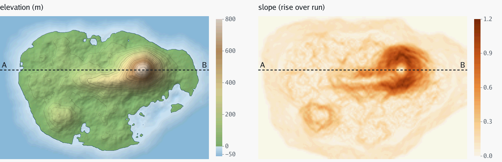
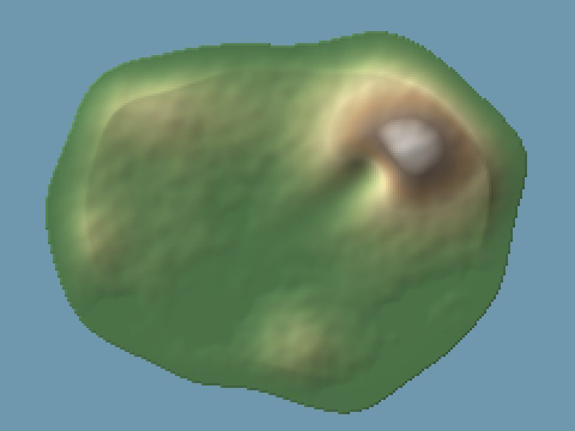
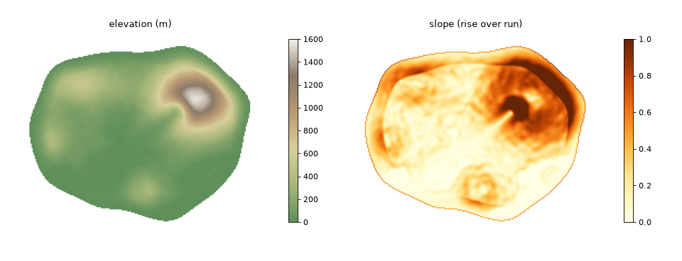
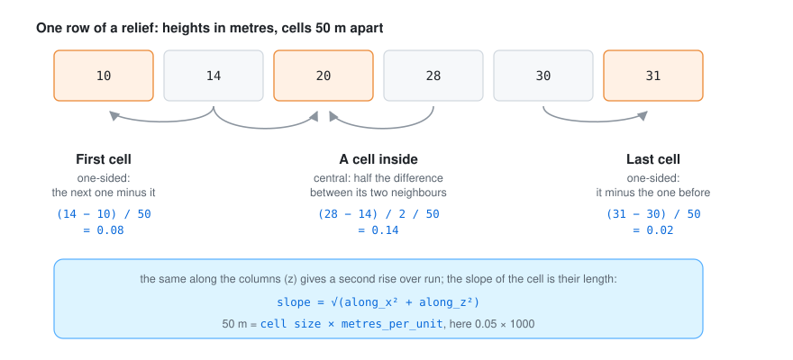
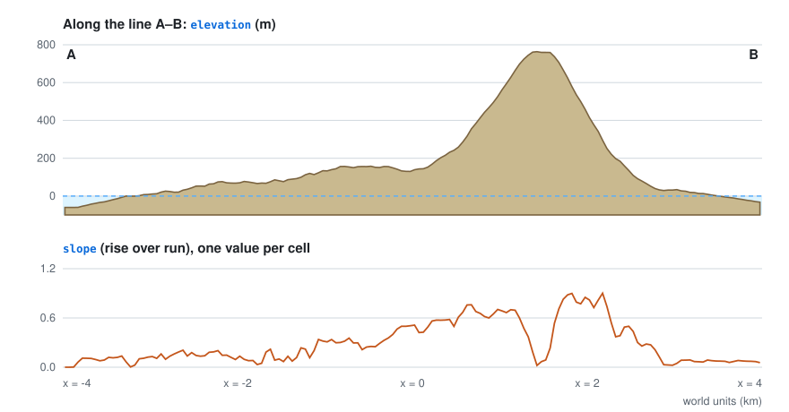
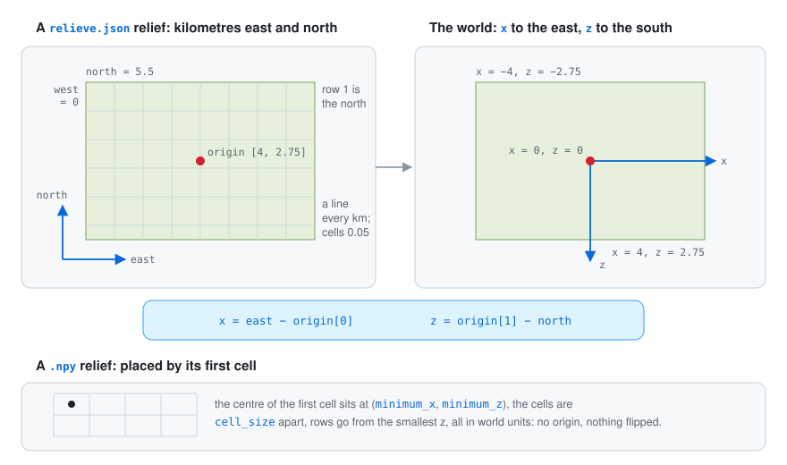

# 🏔️ Reliefs and fields

Almost every simulator needs to know the shape of the land: the climate to know where it is cold,
the forests to know where it is too steep, the town to know where it can build. Instead of each one
loading its own copy of the relief (and maybe disagreeing about it), the terrain plugin reads it
once and puts it in the world for everyone.

<p align="center">
<picture>
  <source media="(prefers-color-scheme: dark)" srcset="images/fields-dark.png">
  
</picture>
</p>

<p align="center"><sub>A made-up island as the other plugins see it: the height of every cell, and how steep it is. Drawn from a real run (see <a href="how-it-works.md#how-the-pictures-were-made">how the pictures were made</a>).</sub></p>

Put it first in the rules file: plugins start in order, so the ones after it find the ground
already there.

## What it publishes

At the start, two fields of the [vocabulary](https://github.com/akrck02/go-simulator/blob/main/docs/vocabulary.md):

| Field | Unit | How |
|---|---|---|
| `elevation` | metres | the relief's heights, untouched |
| `slope` | rise over run | the gradient like `numpy.gradient`: central differences inside, one-sided at the edges |

Values sit at cell centres, rows from the smallest z and columns from the smallest x. The ground
does not change with time, so later steps publish nothing.

Another made-up island, shaded, and its two fields:

<table>
<tr>
<th width="50%">The island, shaded</th>
<th width="50%">Its two fields</th>
</tr>
<tr>
<td></td>
<td></td>
</tr>
</table>

## How the slope is measured

<p align="center">
  
</p>

Every cell gets two rises over run, one along the row (x) and one along the column (z), taken like
`numpy.gradient`: half the difference between the two neighbours inside the grid, and the
difference with the only neighbour at the edges. The slope is the length of those two,
`√(along_x² + along_z²)`. The numbers in the picture are what the plugin's own code gives for that
row.

The distance between cells is in metres, so the slope is a true rise over run: the cell size in
world units times `metres_per_unit` (1000 by default, for scenes in kilometres). A slope of 1 is a
45° flank.

<p align="center">
  
</p>

<p align="center"><sub>One row of the island's two fields, along the dashed line A–B in the picture at the top. The slope is highest on the flanks and drops on the rounded summit, where the neighbours on both sides are lower.</sub></p>

## Formats

The rule tells the two apart by the end of `path`: `.json` or `.npy`.

<p align="center">
  
</p>

### go-scene-builder's relief

`relieve.json`, `{"columns", "rows", "cell", "west", "north", "units"}`, with the heights in metres
as little-endian float32 in `relieve.f32` next to it, row by row from the north. Its coordinates
are kilometres east and north; `origin` places it on the world: `x = east − origin[0]`,
`z = origin[1] − north`. Rows go from the north, which is the smallest z, so no row is flipped.

```yaml
- rule: relief
  with: {path: relieve.json, origin: [6, 4.5]}
```

### NumPy array

A two-dimensional `.npy` of float32 or float64 heights in metres, rows from the smallest z, placed
by the centre of its first cell and the spacing of its cells, in world units.

```yaml
- rule: relief
  with: {path: relief.npy, minimum_x: -1, minimum_z: -1, cell_size: 0.0125}
```

`metres_per_unit` (1000 for scenes in kilometres) turns the cell size into metres for the slope.

The island in these pictures was written both ways, as a `relieve.json` with `origin: [4, 2.75]`
and as a `.npy` with `minimum_x: -3.975`, `minimum_z: -2.725` and `cell_size: 0.05`; the two runs
published byte-identical fields.

## Exactness

The field's extent is float64, so a plugin that rebuilds the grid from the field gets the same
cell size and cell centres as the file. This matters for simulations that are sensitive to their
inputs: a tenth of a millimetre of difference in the heights can grow a different town.
